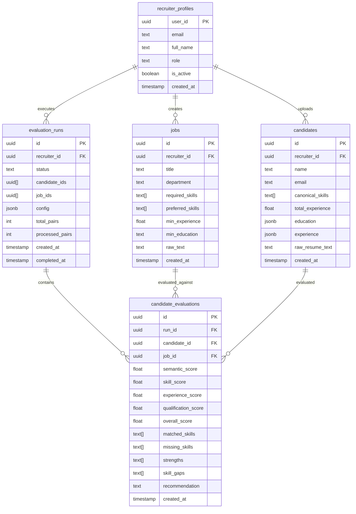

# System Architecture & Technical Specifications

**Project:** Agentic AI Recruitment Intelligence Platform for Large-Scale Multi-Role Candidate Evaluation  
**Version:** 1.0.0 (Production Master)  
**Status:** Frozen & Approved

---

## 1. System Overview & Architecture Topology

The platform is designed for automated, deterministic, and explainable multi-role evaluation of candidate pools against enterprise job descriptions. It integrates asynchronous document processing, LLM-based profile extraction, dense vector search, deterministic multi-criteria scoring, and enterprise-grade Role-Based Access Control (RBAC).

```
+-----------------------------------------------------------------------------------+
|                                React 19 Frontend Shell                             |
|  - Role-gated Navigation: Admin Panel | Recruiter Workspace | Evaluation History  |
|  - Auth Context with Supabase Auth Session & Live Profile Role Resolution         |
+-----------------------------------------------------------------------------------+
                                          |
                                HTTP / REST (JWT Auth)
                                          v
+-----------------------------------------------------------------------------------+
|                                FastAPI Backend Engine                             |
|  - Auth Dependencies: require_admin, require_recruiter_or_admin, require_any_auth |
|  - Routers: /admin, /evaluations, /candidates, /jobs, /health                     |
+-----------------------------------------------------------------------------------+
        |                          |                         |
        v                          v                         v
+------------------+     +-------------------+     +------------------+
| Supabase Storage |     |   FAISS Vector    |     | Gemini 2.5 Flash |
|  - 'resumes'     |     |   Index Engine    |     |  - LLM Profile   |
|  - 'job-descs'   |     | (all-MiniLM-L6-v2)|     |    Extraction    |
+------------------+     +-------------------+     +------------------+
        |                          |                         |
        +--------------------------+-------------------------+
                                   |
                                   v
+-----------------------------------------------------------------------------------+
|                          Supabase PostgreSQL Database                             |
|  - Tables: recruiter_profiles, jobs, candidates, evaluation_runs, candidate_evals |
|  - Row Level Security (RLS) with is_admin() and can_mutate() functions            |
+-----------------------------------------------------------------------------------+
```

---

## 2. Role-Based Access Control (RBAC) Architecture

The application enforces a rigorous three-tier RBAC system across **three defensive layers**: Database (PostgreSQL RLS), Backend API (FastAPI Dependencies), and Frontend UI (Component & Route Guards).

### 2.1 Role Definitions & Permission Matrix

| Operation / Resource | ADMIN | RECRUITER | VIEWER |
| :--- | :---: | :---: | :---: |
| **System Telemetry & Stats** (`GET /admin/stats`) | Allowed | Blocked (403) | Blocked (403) |
| **User Listing & Search** (`GET /admin/users`) | Allowed | Blocked (403) | Blocked (403) |
| **Role Assignment** (`PATCH /admin/users/{id}/role`) | Allowed | Blocked (403) | Blocked (403) |
| **Account Activation/Lockout** (`PATCH /admin/users/{id}/status`)| Allowed | Blocked (403) | Blocked (403) |
| **Upload / Mutate Candidates & Resumes** | Allowed | Allowed | Blocked (403) |
| **Upload / Mutate Job Descriptions** | Allowed | Allowed | Blocked (403) |
| **Execute New Evaluation Runs** | Allowed | Allowed | Blocked (403) |
| **Read Candidate Pool & Details** | Allowed | Allowed | Read-Only |
| **Read Job Descriptions** | Allowed | Allowed | Read-Only |
| **Read Historical Evaluation Runs & Matrices** | Allowed | Allowed | Read-Only |

### 2.2 Layer 1: Database RLS & Security Functions

Database access is protected by PostgreSQL Row Level Security (RLS) policies driven by two security definer functions:
- `public.is_admin()`: Queries `recruiter_profiles` to verify if the requesting `auth.uid()` has `role = 'admin'` and `is_active = true`.
- `public.can_mutate()`: Verifies if the requesting `auth.uid()` is an active user with either `admin` or `recruiter` role.

```sql
-- Security Definer Functions
CREATE OR REPLACE FUNCTION public.is_admin()
RETURNS BOOLEAN LANGUAGE sql STABLE SECURITY DEFINER AS $$
    SELECT EXISTS (
        SELECT 1 FROM public.recruiter_profiles
        WHERE user_id = auth.uid() AND role = 'admin' AND is_active = true
    );
$$;

CREATE OR REPLACE FUNCTION public.can_mutate()
RETURNS BOOLEAN LANGUAGE sql STABLE SECURITY DEFINER AS $$
    SELECT EXISTS (
        SELECT 1 FROM public.recruiter_profiles
        WHERE user_id = auth.uid() AND role IN ('admin', 'recruiter') AND is_active = true
    );
$$;
```

### 2.3 Layer 2: FastAPI Backend Middleware & Dependencies

- `require_any_authenticated`: Verifies user identity and confirms active account status (`is_active == true`).
- `require_recruiter_or_admin`: Enforces mutation authorization; raises `HTTPException(status_code=403, detail="Viewer role is read-only. Action requires recruiter or admin privileges.")` if user has `viewer` role.
- `require_admin`: Strictly limits administrative endpoints to users with `role == "admin"`.
- **Self-Protection Guards:**
  - Prevents admins from demoting their own role.
  - Prevents admins from deactivating their own account.

### 2.4 Layer 3: Frontend Navigation & UI Guards

- **Navigation Shell:** Renders the "Admin Panel" tab exclusively for `isAdmin`. Displays current user role badges (`ADMIN`, `RECRUITER`, `VIEWER`).
- **Viewer Restrictions:** Mutating UI controls (Upload Candidate, Upload JD, Run Evaluation, Clear Database, Delete) are disabled with tooltip warnings or hidden entirely for `isViewer`.
- **Account Suspension Guard:** Deactivated users are instantly routed to a dedicated suspension screen and barred from workspace operations.

---

## 3. Mathematical Evaluation & Fitment Scoring Model

Candidate fitment across multiple job roles is computed deterministically using a hybrid multi-criteria model combining dense semantic similarity and structured categorical signals.

### 3.1 Configurable Weights Formulation

Weights are normalized such that:
$$w_{\text{sem}} + w_{\text{skill}} + w_{\text{exp}} + w_{\text{qual}} = 1.0$$

Default baseline parameters:
- $w_{\text{sem}} = 0.40$ (Semantic Vector Alignment)
- $w_{\text{skill}} = 0.30$ (Direct Skill Overlap & Penalties)
- $w_{\text{exp}} = 0.20$ (Years of Relevant Experience)
- $w_{\text{qual}} = 0.10$ (Degree & Certification Match)

### 3.2 Semantic Similarity ($S_{\text{sem}}$)
Embeddings are generated using `sentence-transformers/all-MiniLM-L6-v2` (384-dimensional dense vectors) from candidate profile representations and job descriptions:
$$\vec{v}_{\text{norm}} = \frac{\vec{v}}{\|\vec{v}\|_2}$$
$$S_{\text{sem}} = \max\left(0.0, \min\left(1.0, \vec{v}_{\text{cand}} \cdot \vec{v}_{\text{job}}\right)\right)$$

### 3.3 Skill Match Scoring ($S_{\text{skill}}$)
Skills are partitioned into **Required** ($S_{\text{req}}$) and **Preferred** ($S_{\text{pref}}$). Canonical skill matching employs set intersection after lowercasing and synonym mapping:
$$R_{\text{req}} = \frac{|S_{\text{cand}} \cap S_{\text{req}}|}{|S_{\text{req}}|}, \quad R_{\text{pref}} = \frac{|S_{\text{cand}} \cap S_{\text{pref}}|}{|S_{\text{pref}}|}$$
$$S_{\text{skill\_base}} = \alpha \cdot R_{\text{req}} + (1 - \alpha) \cdot R_{\text{pref}} \quad (\text{default } \alpha = 0.70)$$

If essential required skills are absent ($|S_{\text{req}} \setminus S_{\text{cand}}| > 0$), a configurable penalty factor $\beta \in [0, 1]$ is applied:
$$S_{\text{skill}} = S_{\text{skill\_base}} \cdot (1 - \beta \cdot (1 - R_{\text{req}}))$$

### 3.4 Experience Scoring ($S_{\text{exp}}$)
Evaluated against required minimum experience ($E_{\text{min}}$) and preferred experience ($E_{\text{pref}}$):
$$S_{\text{exp}} = \begin{cases} 
1.0 & \text{if } E_{\text{cand}} \ge E_{\text{pref}} \\
0.7 + 0.3 \cdot \frac{E_{\text{cand}} - E_{\text{min}}}{E_{\text{pref}} - E_{\text{min}}} & \text{if } E_{\text{min}} \le E_{\text{cand}} < E_{\text{pref}} \\
0.7 \cdot \frac{E_{\text{cand}}}{E_{\text{min}}} & \text{if } E_{\text{cand}} < E_{\text{min}}
\end{cases}$$

### 3.5 Qualification Scoring ($S_{\text{qual}}$)
Mapped to academic hierarchies ($\text{PhD} > \text{Master's} > \text{Bachelor's} > \text{Associate/Diploma}$):
$$S_{\text{qual}} = \begin{cases}
1.0 & \text{if } \text{Tier}_{\text{cand}} \ge \text{Tier}_{\text{req}} \\
0.75 & \text{if } \text{Tier}_{\text{cand}} = \text{Tier}_{\text{req}} - 1 \\
0.50 & \text{if } \text{Tier}_{\text{cand}} = \text{Tier}_{\text{req}} - 2 \\
0.25 & \text{otherwise}
\end{cases}$$

### 3.6 Overall Composite Role-Fit Score
$$S_{\text{final}} = w_{\text{sem}} S_{\text{sem}} + w_{\text{skill}} S_{\text{skill}} + w_{\text{exp}} S_{\text{exp}} + w_{\text{qual}} S_{\text{qual}}$$

---

## 4. Evaluation History & Snapshot Immutability

To guarantee academic reproducibility and recruiter audit compliance:
1. **Immutable Configuration:** Each run stores its exact weight settings ($w_{\text{sem}}, w_{\text{skill}}, w_{\text{exp}}, w_{\text{qual}}, \alpha, \beta$) within `evaluation_runs.config`.
2. **Pre-computed Fitment Records:** Candidate fitment results, strengths, gaps, and reasoning explanations are persisted as immutable rows in `candidate_evaluations`.
3. **No Recalculation on Review:** Reopening historical evaluations in the frontend loads stored scores from the database without re-invoking the embedding model or recalculating metrics.

---

## 5. PostgreSQL Database Schema Specification


